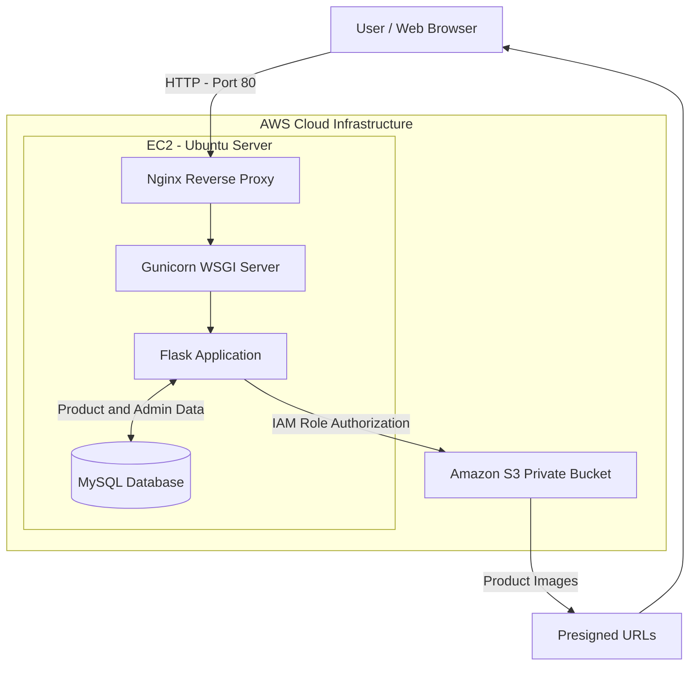

# CloudStore
## Cloud-Based E-Commerce Product Management System

### 1. Project Overview
CloudStore is a cloud-based e-commerce product management application developed using Python Flask, MySQL and Amazon Web Services.

It allows administrators to manage products and securely store product images in Amazon S3.

### 2. Technologies Used
- Python
- Flask
- MySQL
- AWS EC2
- AWS S3
- AWS IAM
- Gunicorn
- Nginx
- HTML
- Bootstrap 5.3.3
- Git and GitHub

### 3. Main Features
- Administrator login
- Product listing
- Add products
- Edit products
- Delete products
- Upload product images to S3
- Retrieve private images using presigned URLs
- MySQL database integration

### 4. AWS Architecture
1. Users access the application through a web browser.
2. Nginx receives HTTP requests on port 80.
3. Nginx forwards requests to Gunicorn.
4. Gunicorn runs the Flask application.
5. Flask communicates with MySQL on EC2.
6. Flask accesses private Amazon S3 using an EC2 IAM role.
7. Product images are displayed using presigned URLs.

### 5. Database
Database name: ecommerce_db

Main tables:
- products
- admin_users

### 6. Project Structure

```text
CloudStore/
├── app.py
├── config.py
├── create_admin.py
├── requirements.txt
├── s3_config.py
├── .gitignore
├── README.md
└── templates/
    ├── index.html
    ├── admin_login.html
    ├── admin_dashboard.html
    ├── add_product.html
    └── edit_product.html

## 14. AWS Architecture Diagram

The following diagram illustrates the CloudStore deployment architecture.


